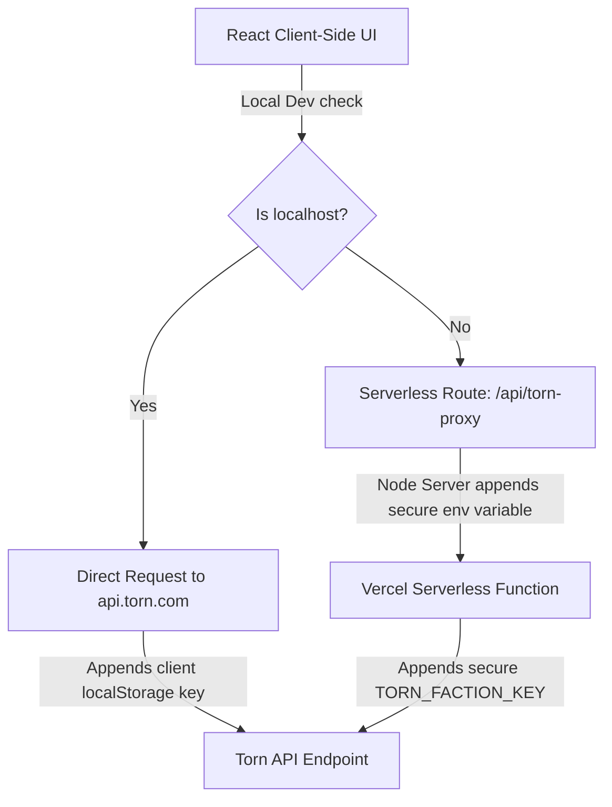

# System Architecture & Technical Specifications

This document describes the technical architecture, component flow, security mechanics, and design layout of the **Torn API Faction Tool**.

---

## 🔒 Dual-Mode API Proxy Design

To safely handle sensitive API keys (particularly the Faction Leader's full-access API key) while supporting frictionless local development, the system implements a dual-mode routing proxy layer.



### 1. Local Development Mode
- **Condition**: Running on `localhost` or `127.0.0.1`.
- **Behavior**: Direct queries are sent from the client's browser to `https://api.torn.com/v2/...` or `https://api.torn.com/faction/...`.
- **Authentication**: Fetches and appends the developer's personal API key stored in client `localStorage` under `tornApiKey`.
- **Benefit**: Permits rapid front-end Hot Module Replacement (HMR) without needing the Vercel CLI server daemon running locally.

### 2. Production Mode (Vercel Proxy)
- **Condition**: Running in production (e.g., deployed on Vercel).
- **Behavior**: Client queries are dispatched locally to the serverless proxy path `/api/torn-proxy`.
- **Security Logic**:
  - The node handler in [api/torn-proxy.js](file:///c:/Users/sgent/OneDrive/Desktop/TORN%20API%20FACTION%20TOOL/api/torn-proxy.js) intercepts the call.
  - It appends the server-side environment secret `TORN_FACTION_KEY`.
  - It replicates headers and forwards the query securely to Torn.
  - **Restriction filter**: Explicitly restricts outgoing requests to endpoints starting with `/v2/faction`, `/faction`, or `/torn`. This prevents unauthorized clients from utilizing the Leader's key to fetch user data or query companies.
- **Client key isolation**: The client-side application never sees, receives, or stores the Faction Leader's API key.

### 3. Personal User Endpoints
- To avoid overloading the faction proxy or leaking personal data, all user-specific endpoints (e.g., [src/services/api.js:fetchUserData](file:///c:/Users/sgent/OneDrive/Desktop/TORN%20API%20FACTION%20TOOL/src/services/api.js#L147-L164)) are executed **client-side only**. They always use the individual key from `localStorage.getItem('tornApiKey')`.

---

## 📊 Global State & Vitals Telemetry

Global application state is managed via React Context in [src/context/DataContext.jsx](file:///c:/Users/sgent/OneDrive/Desktop/TORN%20API%20FACTION%20TOOL/src/context/DataContext.jsx).

### Exposed State Variables
- `userName`: The active user's character handle.
- `factionName`: The target faction's name.
- `hospitalCount`: Number of members currently in the hospital.
- `userHospitalStatus`: Tracks whether the current logged-in user is in the hospital.

### Automated Background Polling
The main container [src/components/Layout.jsx](file:///c:/Users/sgent/OneDrive/Desktop/TORN%20API%20FACTION%20TOOL/src/components/Layout.jsx) registers a 30-second interval:
- Queries [fetchUserSpecific](file:///c:/Users/sgent/OneDrive/Desktop/TORN%20API%20FACTION%20TOOL/src/services/api.js#L166-L184) for personal stats (`life`, `energy`, `nerve`, `happy`).
- Queries [fetchFactionData](file:///c:/Users/sgent/OneDrive/Desktop/TORN%20API%20FACTION%20TOOL/src/services/api.js#L51-L64) to sync faction chain telemetry.
- Updates the top bar header dynamically with styled, neon-glowing vitals progress indicators.

---

## 🎨 Visual System & Dynamic Styling

The user interface follows a modern dark theme with vibrant page-specific styling.

### 1. Page-Specific Theme Injectors
Every page contains a `useEffect` layout component that dynamically swaps global CSS accent variables on the `document.documentElement` during mount and restores defaults upon unmounting:
- **Faction Roster**: Purple/magenta layout theme (`--accent-primary: #a855f7`, `--accent-secondary: #d946ef`).
- **War Room**: Aggressive crimson red theme (`--accent-primary: #ef4444`, `--accent-secondary: #94a3b8`).
- **Armory**: Industrial silver/brass theme (`--accent-primary: #cbd5e1`, `--accent-secondary: #f59e0b`).

### 2. Ambient Hospital Alarms
In [src/components/Layout.jsx](file:///c:/Users/sgent/OneDrive/Desktop/TORN%20API%20FACTION%20TOOL/src/components/Layout.jsx), we combine faction alarms with user status to dynamically render defensive alerts:
```javascript
const baseIntensity = Math.min(0.05 + (hospitalCount * 0.02) + (userHospitalStatus * 0.4), 0.6);
const blurRadius = Math.min(100 + (hospitalCount * 10) + (userHospitalStatus * 200), 500);
```
This projects a pulsing, red glow border shadow across the entire layout container if the faction is under siege or if the user gets hospitalized.

---

## 🔗 Route & Component Directory mapping

The frontend router maps the dashboard pages under [src/App.jsx](file:///c:/Users/sgent/OneDrive/Desktop/TORN%20API%20FACTION%20TOOL/src/App.jsx):

| Path | React Page Component | Purpose | Key API Selections |
|---|---|---|---|
| `/` | `FactionPage.jsx` | Roster, respect stats, online states, sorting. | `basic,members` (V2) |
| `/faction/war-room` | `FactionWarRoom.jsx` | Real-time war tracking, operative logs, active chain multiplier. | `basic,members,attacks,chain,wars,rankedwars,territorywars` (V2) |
| `/faction/attacks` | `FactionAttacks.jsx` | Historical logging of attacks. | `attacks` (V2) |
| `/faction/armory` | `FactionArmory.jsx` | Inventory quantities, weapon loads, 30-day medical/xanax logs. | `weapons,armor,medical,drugs,currency` (V1 fallback) + `armorynews` |
| `/faction/funds` | `FactionFunds.jsx` | Bank, payouts, points ledger, deposit logs. | `balance` (V2) + `news/depositFunds` + `news/giveFunds` |
| `/faction/past-wars` | `PastWars.jsx` | Historical war scores and reports. | `rankedwars` (V2) + `rankedwarreport` (V1) |
| `/user` | `UserPage.jsx` | User status details and profile values. | `profile,basic,bars,job,faction` (V2) |
| `/user/*` | `UserSubPages.jsx` | Crimes logs, flight trackers, personal stats. | `crimes`, `travel`, `personalstats` (V2) |
